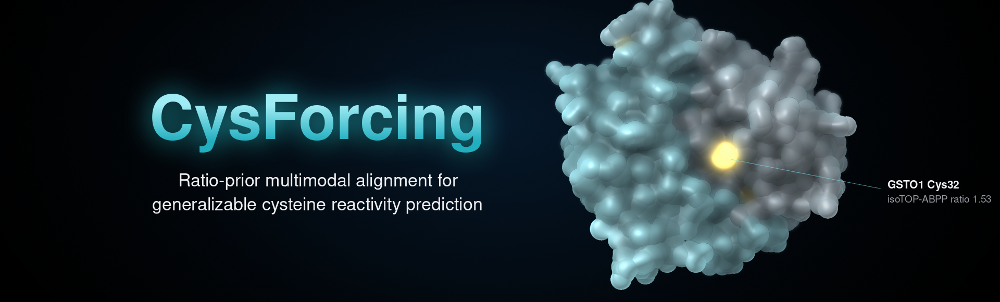
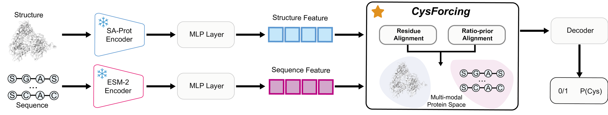
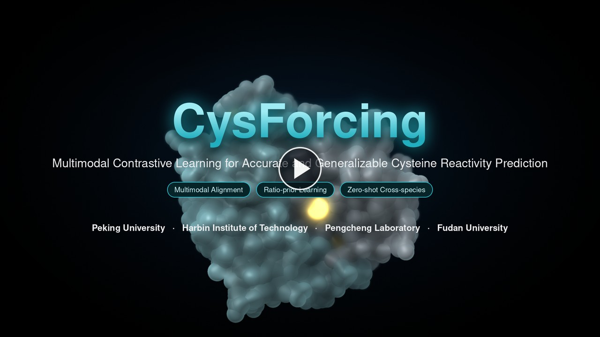

<p align="center">
  
</p>

<p align="center">
  <a href="https://doi.org/10.5281/zenodo.XXXXXXX"></a>
  <a href="#demo"></a>
  
  
  <a href="LICENSE"></a>
</p>

Code, trained weights and figure scripts for

**Ratio-prior Multimodal Alignment for Generalizable Cysteine Reactivity Prediction**<br>
Hongyu Zhang, Feng Zhang, Fengzhang Wang, Zihua Liu, Yudi Guo, Zhiwei Nie\*, Chu Wang\*, Jie Chen\*, Yuan Liu\*<br>
<sub>Peking University · Fudan University · Harbin Institute of Technology, Shenzhen · Pengcheng Laboratory &nbsp;·&nbsp; \*corresponding authors</sub>

## Overview

CysForcing predicts which cysteines of a protein are reactive from its sequence and AlphaFold2 structure. Two small adapters map frozen ESM-2 and SaProt embeddings into one space and align them residue by residue; measured isoTOP-ABPP competition ratios then act as a prior on that space, so that sites of similar reactivity sit close together. Only 1.9M parameters are trained.

<p align="center"></p>

## Results

| Evaluation | Metric | Strongest baseline | CysForcing | Gain |
|:--|:--:|:--|:--:|:--:|
| Held-out proteins, ≤40% identity to training | F1 | 0.439 (ESM2-3B) | **0.542** | +0.103 |
| Zero-shot, *M. musculus* (606 sites) | AUROC | 0.596 (sbPCR) | **0.872** | +0.276 |
| Zero-shot, *S. typhimurium* SL1344 (317 sites) | AUROC | 0.593 (CIAA RF) | **0.761** | +0.168 |
| Zero-shot, CIAA AF2-denovo (476 sites) | AUROC | 0.572 (sbPCR) | **0.724** | +0.152 |
| Zero-shot sites with no measured homolog (69–84%) | AUROC | ≈0.50 (homology transfer) | **0.68–0.83** | +0.18 to +0.33 |

Baselines are five protein foundation models (ESM-2 650M/3B/15B, SaProt 650M/1B) on the held-out split, and the released predictors CIAA, HyperCys and sbPCR on the zero-shot sets, scored on the same sites and structures with sites labelled hyper-reactive at ratio ≤ 2.3 and low-reactive at ≥ 10. The paper reports every similarity cutoff, the ablations and the significance tests; `bash paper/run_all.sh` regenerates all of them.

## Demo

<p align="center">
  <a href="assets/demo.mp4"></a><br>
  <sub>Two-minute walkthrough of the results (click to play)</sub>
</p>

## Getting started

**Environment.** Python ≥ 3.10. Install PyTorch from the CUDA index first, then the requirements:

```bash
conda create -n cysforcing python=3.10 -y && conda activate cysforcing
pip install torch==1.12.1+cu113 torchvision==0.13.1+cu113 --extra-index-url https://download.pytorch.org/whl/cu113
pip install -r requirements.txt
```

SaProt and foldseek are not redistributed: put [SaProt_650M_AF2](https://huggingface.co/westlake-repl/SaProt_650M_AF2) at `SaProt_650M_AF2/SaProt_650M_AF2/` and the foldseek binary at `SaProt_650M_AF2/bin/foldseek`, under the repository root. ESM-2 downloads on first use.

**Predict** every cysteine in a folder of PDB files; the output JSON gives each site a reactivity probability:

```bash
python simple_inference.py --model configs/model/CysForcing.yaml --weight weights/CysForcing.pth \
    --pdb_folder /path/to/pdbs --out_dir result_inference/mine
```

**Data.** The training and evaluation sets are on [Zenodo](https://doi.org/10.5281/zenodo.XXXXXXX) ([format](data/README.md)); structures come from AlphaFold DB:

```bash
unzip CysForcing-data-v1.0.zip && cp -r CysForcing-data-v1.0/data/* data/
awk -F',' 'FNR>1{print $1}' data/splits/*.csv | sort -u > /tmp/uniprots.txt
python scripts/get_AF2.py -i /tmp/uniprots.txt -o data/raw/AF2_pdb -j 12
python scripts/build_features.py -i data/raw/AF2_pdb -o data/features    # ~24 GB, resumable
```

**Train.**

```bash
python main.py --model configs/model/CysForcing.yaml --data configs/data/cys.yaml
```

**Reproduce the paper.**

```bash
python reproduce/eval_homology.py   # held-out proteins at 100 / 80 / 60 / 40 % identity
bash reproduce/run_ood.sh           # zero-shot mouse and SL1344
bash reproduce/run_ciaa.sh          # zero-shot CIAA AF2-denovo
bash paper/run_all.sh               # all figures from paper/data, CPU only
```

[paper/README.md](paper/README.md) describes the figure source data.

## Citation

```bibtex
@article{zhang2026cysforcing,
  title   = {Ratio-prior Multimodal Alignment for Generalizable Cysteine Reactivity Prediction},
  author  = {Zhang, Hongyu and Zhang, Feng and Wang, Fengzhang and Liu, Zihua and Guo, Yudi and
             Nie, Zhiwei and Wang, Chu and Chen, Jie and Liu, Yuan},
  journal = {Under review},
  year    = {2026}
}
```

## License

MIT, see [LICENSE](LICENSE). CysForcing builds on [ESM-2](https://github.com/facebookresearch/esm), [SaProt](https://github.com/westlake-repl/SaProt), [DrugBAN](https://github.com/peizhenbai/DrugBAN), [foldseek](https://github.com/steineggerlab/foldseek) and [AlphaFold DB](https://alphafold.ebi.ac.uk/); [THIRD_PARTY_NOTICES.md](THIRD_PARTY_NOTICES.md) lists their licences and the sources of the released data.
